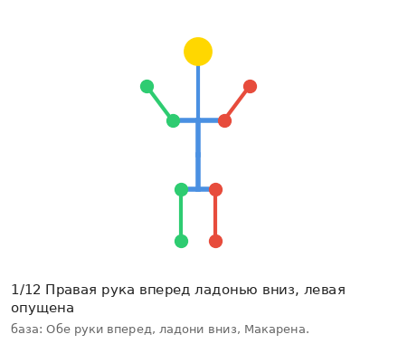

# MLOps 2025: домашние задания

Курс «Сценарии сборки моделей машинного обучения», материалы курса: [tam2511/mlops2025](https://github.com/tam2511/mlops2025).
Студент: Зиядинов Арсен Рустемович, группа МИВТ-25-3.

| Урок | Задание | Папка | Итог |
|---|---|---|---|
| 2. DVC + Great Expectations | [Model Validation and Metrics](https://github.com/tam2511/mlops2025/blob/main/lesson2/seminar/step5_homework_model_validation_and_metrics/README.md) | [lesson2_model_validation](lesson2_model_validation/) | Poetry и pre-commit, метрики в `metrics/metrics.json`, стадия `validate_model` останавливает пайплайн при `accuracy < accuracy_min` |
| 4. ONNX + FastAPI | [Мониторинг FastAPI-сервиса](https://github.com/tam2511/mlops2025/blob/main/lesson4/seminar/step4_monitoring/README.md) | [lesson4_monitoring](lesson4_monitoring/) | проверки `/health` и `/predict`, response time, P95, error rate, consecutive failures, цветные алерты с cooldown, JSON-логи и JSONL-метрики |
| 6. LLMOps | [RAG Animation System](https://github.com/tam2511/mlops2025/blob/main/lesson6/seminar/step3_rag/README.md) | [lesson6_rag_animation](lesson6_rag_animation/) | по запросу «танец макарена» LLM описывает позы, TF-IDF находит проверенные позы в базе, Pose API рисует кадры, получается GIF |



## Устройство репозитория

- Каждое ДЗ лежит в своей папке и является отдельным Poetry-проектом со своими `pyproject.toml` и `poetry.lock`.
- Один `.pre-commit-config.yaml` в корне (black, ruff, isort, end-of-file-fixer, check-yaml) проверяет код всех ДЗ.
- В уроках 4 и 6 есть тесты: `poetry run pytest` в папке урока. Они не требуют ни модели, ни запущенных сервисов.

```bash
git clone https://github.com/BalleNz/mlops2025-homework.git
cd mlops2025-homework/lesson2_model_validation && poetry install && poetry run pre-commit install
```

Подробности запуска и результаты: в README каждой папки.
