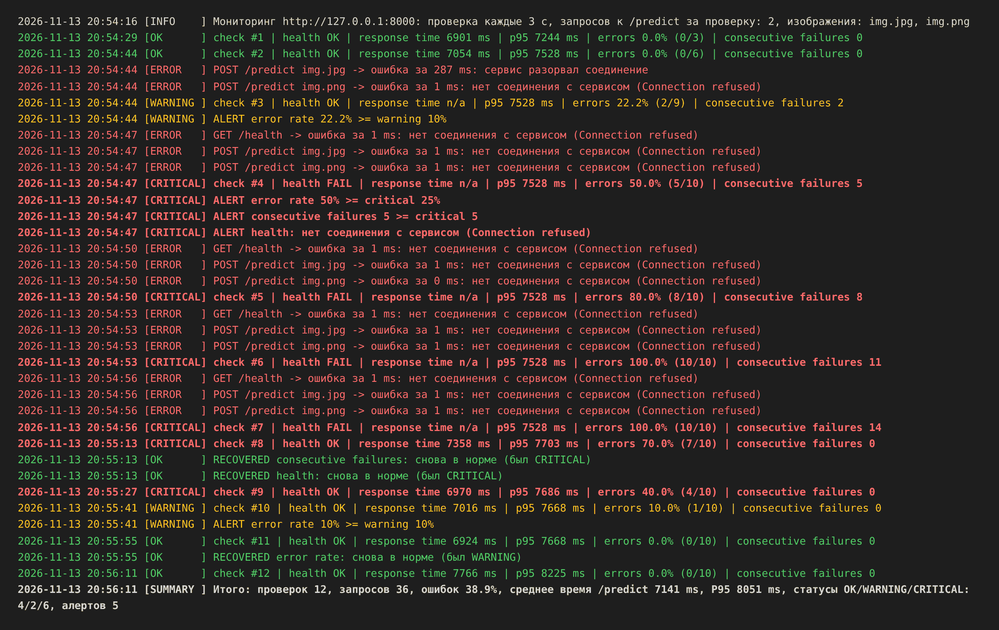

# Урок 4: мониторинг FastAPI-сервиса инференса

Домашнее задание по курсу «Сценарии сборки моделей машинного обучения», урок 4 (ONNX + FastAPI).
Студент: Зиядинов Арсен, МИВТ-25-3.

Задание: [step4_monitoring](https://github.com/tam2511/mlops2025/blob/main/lesson4/seminar/step4_monitoring/README.md).
Объект мониторинга: сервис [step2_fastapi_inference](https://github.com/tam2511/mlops2025/tree/main/lesson4/seminar/step2_fastapi_inference) с ONNX-моделью BLIP (image captioning) из шага 1.

## Что сделано

| Требование | Реализация |
|---|---|
| Интеграция с сервисом шага 2 | подключение к запущенному сервису (`--base-url`) или запуск сервиса из монитора (`--start-service`): подпроцесс, ожидание `/health`, остановка в конце; эндпоинты `/health` и `/predict` |
| Метрики | response time, P95 latency, error rate, health status, consecutive failures |
| Тестирование инференса | POST картинок `jpg` и `png` на `/predict` по кругу; в лог идут время на клиенте и на сервере и подпись модели; ответ проверяется: `success`, непустое описание, `result.timing.total_ms`, `image_size` совпадает с настоящим размером картинки |
| Цветные алерты | зелёный OK, жёлтый WARNING, красный CRITICAL; смена уровня и восстановление (`RECOVERED`) сообщаются сразу, тот же уровень повторяется не чаще `cooldown_minutes` |
| Конфигурация | `config/monitoring_config.yaml` в формате из задания плюс необязательные поля: тестовые картинки, окно метрик, команда запуска сервиса; проверка значений (числа больше нуля, warning не больше critical) |
| Логирование | JSON-строки с временем в `logs/monitoring.log`, по одной записи на проверку в `logs/metrics.jsonl`, цветная консоль с временем у каждого события |
| Тесты | `tests/test_monitor.py`: перцентиль, пороги, проверка ответа, cooldown алертов, полный цикл сбоя и восстановления на фейковом сервисе (модель не нужна) |

| Файл | Назначение |
|---|---|
| `main.py` | точка входа, параметры командной строки |
| `src/monitor.py` | проверки, метрики, алерты, запуск сервиса |
| `src/logger.py` | цветная консоль, JSON-логи, JSONL-метрики |
| `src/config.py` | загрузка и проверка YAML |
| `config/monitoring_config.yaml` | конфиг из задания |
| `config/demo_slow_cpu.yaml` | пороги под слабый CPU для демонстрации |
| `test_images/` | `img.jpg` из шага 2 и `img.png` |
| `examples/` | логи демонстрационного запуска |
| `logs/` | создаётся автоматически |

## Как считаются метрики

- **Response time**: среднее время успешных запросов к `/predict` в текущей проверке.
- **P95 latency**: 95-й перцентиль (линейная интерполяция, как в `numpy.percentile`) по успешным запросам к `/predict` из окна последних `metrics_window` запросов.
- **Error rate**: доля неуспешных запросов к `/health` и `/predict` в том же окне. Неуспех: нет соединения, таймаут, HTTP-код не 200 или ответ не прошёл проверку.
- **Health status**: `/health` вернул 200 и `status: healthy`, иначе статус CRITICAL.
- **Consecutive failures**: сколько запросов подряд закончились ошибкой.

Порог срабатывает, когда значение достигло его или превысило. Статус проверки: худший из статусов метрик.

## Запуск

Сервис шага 2 (в репозитории курса):

```bash
cd mlops2025/lesson4/seminar/step1_onnx_model
poetry install && poetry run python main.py          # экспорт BLIP в models/blip_model.onnx
cd ../step2_fastapi_inference
cp ../step1_onnx_model/models/blip_model.onnx models/
poetry install && poetry run python main.py          # http://localhost:8000
```

Мониторинг:

```bash
cd lesson4_monitoring
poetry install
poetry run python main.py                # бесконечно, Ctrl+C для остановки и итога
poetry run python main.py --checks 5     # 5 проверок и итог
```

Запуск сервиса самим монитором: команда из `service.start_command` выполняется в папке сервиса, после мониторинга сервис останавливается.

```bash
poetry run python main.py --start-service --service-dir ../mlops2025/lesson4/seminar/step2_fastapi_inference
```

Другие параметры: `--config`, `--interval`, `--samples`, `--base-url`, `--service-cmd`, `--no-color`. Команды Make: `make install`, `make monitor`, `make test`, `make lint`.

## Результат

Проверено на настоящем сервисе шага 2: BLIP в ONNX Runtime на машине с 2 vCPU без GPU. Модель отвечает за 7 с с небольшим, например `"a man fishing on a boat at sunset"`.

**1. Пороги из задания.** На такой машине мониторинг сразу поднимает CRITICAL по времени ответа:

```
$ poetry run python main.py --checks 1
2026-11-13 20:56:16 [INFO    ] Мониторинг http://127.0.0.1:8000: проверка каждые 30 с, запросов к /predict за проверку: 3, изображения: img.jpg, img.png
2026-11-13 20:56:16 [INFO    ] GET /health -> 200, 3 ms
2026-11-13 20:56:23 [INFO    ] POST /predict img.jpg -> 200, 7246 ms (на сервере 7243 ms): "a man fishing on a boat at sunset"
2026-11-13 20:56:31 [INFO    ] POST /predict img.png -> 200, 7914 ms (на сервере 7910 ms): "a man fishing on a boat in the water"
2026-11-13 20:56:38 [INFO    ] POST /predict img.jpg -> 200, 6833 ms (на сервере 6830 ms): "a man fishing on a boat at sunset"
2026-11-13 20:56:38 [CRITICAL] check #1 | health OK | response time 7331 ms | p95 7847 ms | errors 0.0% (0/4) | consecutive failures 0
2026-11-13 20:56:38 [CRITICAL] ALERT response time 7331 ms >= critical 5000 ms
2026-11-13 20:56:38 [CRITICAL] ALERT P95 latency 7847 ms >= critical 6000 ms
2026-11-13 20:56:38 [SUMMARY ] Итого: проверок 1, запросов 4, ошибок 0.0%, среднее время /predict 7331 ms, P95 7847 ms, статусы OK/WARNING/CRITICAL: 0/0/1, алертов 2
```

**2. Сбой и восстановление.** Профиль `config/demo_slow_cpu.yaml`: пороги времени ответа подняты под этот CPU, окно метрик 10 запросов. После второй проверки процесс сервиса убит (`kill -9`), после пятой запущен снова.



<details>
<summary>Тот же вывод текстом</summary>

```
$ poetry run python main.py --config config/demo_slow_cpu.yaml --checks 12
2026-11-13 20:54:16 [INFO    ] Мониторинг http://127.0.0.1:8000: проверка каждые 3 с, запросов к /predict за проверку: 2, изображения: img.jpg, img.png
2026-11-13 20:54:29 [OK      ] check #1 | health OK | response time 6901 ms | p95 7244 ms | errors 0.0% (0/3) | consecutive failures 0
2026-11-13 20:54:44 [OK      ] check #2 | health OK | response time 7054 ms | p95 7528 ms | errors 0.0% (0/6) | consecutive failures 0
2026-11-13 20:54:44 [ERROR   ] POST /predict img.jpg -> ошибка за 287 ms: сервис разорвал соединение
2026-11-13 20:54:44 [ERROR   ] POST /predict img.png -> ошибка за 1 ms: нет соединения с сервисом (Connection refused)
2026-11-13 20:54:44 [WARNING ] check #3 | health OK | response time n/a | p95 7528 ms | errors 22.2% (2/9) | consecutive failures 2
2026-11-13 20:54:44 [WARNING ] ALERT error rate 22.2% >= warning 10%
2026-11-13 20:54:47 [ERROR   ] GET /health -> ошибка за 1 ms: нет соединения с сервисом (Connection refused)
2026-11-13 20:54:47 [ERROR   ] POST /predict img.jpg -> ошибка за 1 ms: нет соединения с сервисом (Connection refused)
2026-11-13 20:54:47 [ERROR   ] POST /predict img.png -> ошибка за 1 ms: нет соединения с сервисом (Connection refused)
2026-11-13 20:54:47 [CRITICAL] check #4 | health FAIL | response time n/a | p95 7528 ms | errors 50.0% (5/10) | consecutive failures 5
2026-11-13 20:54:47 [CRITICAL] ALERT error rate 50% >= critical 25%
2026-11-13 20:54:47 [CRITICAL] ALERT consecutive failures 5 >= critical 5
2026-11-13 20:54:47 [CRITICAL] ALERT health: нет соединения с сервисом (Connection refused)
2026-11-13 20:54:50 [ERROR   ] GET /health -> ошибка за 1 ms: нет соединения с сервисом (Connection refused)
2026-11-13 20:54:50 [ERROR   ] POST /predict img.jpg -> ошибка за 1 ms: нет соединения с сервисом (Connection refused)
2026-11-13 20:54:50 [ERROR   ] POST /predict img.png -> ошибка за 0 ms: нет соединения с сервисом (Connection refused)
2026-11-13 20:54:50 [CRITICAL] check #5 | health FAIL | response time n/a | p95 7528 ms | errors 80.0% (8/10) | consecutive failures 8
2026-11-13 20:54:53 [ERROR   ] GET /health -> ошибка за 1 ms: нет соединения с сервисом (Connection refused)
2026-11-13 20:54:53 [ERROR   ] POST /predict img.jpg -> ошибка за 1 ms: нет соединения с сервисом (Connection refused)
2026-11-13 20:54:53 [ERROR   ] POST /predict img.png -> ошибка за 1 ms: нет соединения с сервисом (Connection refused)
2026-11-13 20:54:53 [CRITICAL] check #6 | health FAIL | response time n/a | p95 7528 ms | errors 100.0% (10/10) | consecutive failures 11
2026-11-13 20:54:56 [ERROR   ] GET /health -> ошибка за 1 ms: нет соединения с сервисом (Connection refused)
2026-11-13 20:54:56 [ERROR   ] POST /predict img.jpg -> ошибка за 1 ms: нет соединения с сервисом (Connection refused)
2026-11-13 20:54:56 [ERROR   ] POST /predict img.png -> ошибка за 1 ms: нет соединения с сервисом (Connection refused)
2026-11-13 20:54:56 [CRITICAL] check #7 | health FAIL | response time n/a | p95 7528 ms | errors 100.0% (10/10) | consecutive failures 14
2026-11-13 20:55:13 [CRITICAL] check #8 | health OK | response time 7358 ms | p95 7703 ms | errors 70.0% (7/10) | consecutive failures 0
2026-11-13 20:55:13 [OK      ] RECOVERED consecutive failures: снова в норме (был CRITICAL)
2026-11-13 20:55:13 [OK      ] RECOVERED health: снова в норме (был CRITICAL)
2026-11-13 20:55:27 [CRITICAL] check #9 | health OK | response time 6970 ms | p95 7686 ms | errors 40.0% (4/10) | consecutive failures 0
2026-11-13 20:55:41 [WARNING ] check #10 | health OK | response time 7016 ms | p95 7668 ms | errors 10.0% (1/10) | consecutive failures 0
2026-11-13 20:55:41 [WARNING ] ALERT error rate 10% >= warning 10%
2026-11-13 20:55:55 [OK      ] check #11 | health OK | response time 6924 ms | p95 7668 ms | errors 0.0% (0/10) | consecutive failures 0
2026-11-13 20:55:55 [OK      ] RECOVERED error rate: снова в норме (был WARNING)
2026-11-13 20:56:11 [OK      ] check #12 | health OK | response time 7766 ms | p95 8225 ms | errors 0.0% (0/10) | consecutive failures 0
2026-11-13 20:56:11 [SUMMARY ] Итого: проверок 12, запросов 36, ошибок 38.9%, среднее время /predict 7141 ms, P95 8051 ms, статусы OK/WARNING/CRITICAL: 4/2/6, алертов 5
```

</details>

Строки запросов к `/predict` в выводе выше сокращены, полный лог этого запуска: [examples/monitoring.log](examples/monitoring.log), метрики по проверкам: [examples/metrics.jsonl](examples/metrics.jsonl).

Тесты:

```
$ poetry run pytest -q
......                                                                   [100%]
6 passed
```
