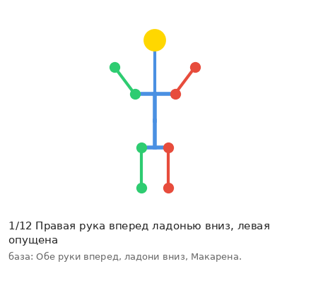
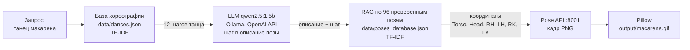

# Урок 6: RAG-система анимаций

Домашнее задание по курсу «Сценарии сборки моделей машинного обучения», урок 6 (LLMOps).
Студент: Зиядинов Арсен, МИВТ-25-3.

Задание: [step3_rag](https://github.com/tam2511/mlops2025/blob/main/lesson6/seminar/step3_rag/README.md). Вход: текстовый запрос, выход: GIF-анимация.
Критерий: по запросу «танец макарена» система создаёт GIF танца Макарена.



## Как устроено



1. **База хореографии** (`data/dances.json`): что делать в танце, без координат. Запрос сопоставляется с названиями и синонимами танцев через TF-IDF на символьных n-граммах. Для Макарены там 12 шагов: руки вперёд ладонями вниз и вверх, к плечам, на затылок, на бёдра, покачивание и прыжок.
2. **LLM** `qwen2.5:1.5b` через OpenAI-совместимый API Ollama (сервис шага 1) переводит каждый шаг в короткое описание позы словами базы поз. Запрос делается на каждый шаг отдельно, с тремя примерами не из Макарены: на списке из 12 строк маленькая модель начинала повторять одну и ту же строку, а на одном шаге работает стабильно. Если танца в базе нет, LLM сама раскладывает движение на позы.
3. **RAG по позам** (`data/poses_database.json`, 96 поз): TF-IDF по описаниям, косинусная близость. Ищем сразу по двум формулировкам, ответу LLM и исходному шагу, и усредняем близость: ошибка одной формулировки меньше портит выбор. Исходный запрос даёт небольшой бонус позам, где упомянут тот же танец. Если лучшая поза совпадает с предыдущим кадром, а следующая почти так же близка (не меньше 97% от лучшей), берём её, иначе повтор оставляем: это пауза в движении.
4. **Pose API** (сервис шага 2, `services/pose_api.py`) рисует каждую позу. Кадры приводятся к одному размеру, пустые поля обрезаются по общей для всех кадров рамке, под кадром подпись: что сказала LLM и какая поза найдена.
5. **GIF**: Pillow, 500 мс на кадр, бесконечный цикл. Рядом сохраняется трассировка `output/macarena.json`: шаги, ответы LLM, найденные позы, близость, время этапов.

Координаты всегда берутся из проверенной базы, LLM их не придумывает. В этом смысл RAG из задания: маленькая модель путается в числах, но хорошо справляется с текстом.

| Файл | Назначение |
|---|---|
| `main.py` | точка входа: `python main.py "танец макарена"` |
| `src/retriever.py` | TF-IDF поиск поз и танцев |
| `src/llm_client.py` | промпты и запросы к LLM |
| `src/pose_api.py` | клиент Pose API |
| `src/animation.py` | кадры, подписи, GIF |
| `src/pipeline.py` | весь конвейер и трассировка |
| `data/poses_database.json` | база поз из задания, без изменений |
| `data/dances.json` | база хореографии |
| `services/pose_api.py` | Pose API из шага 2, без изменений логики |
| `docker-compose.yml` | Ollama (порт 11434) и Pose API (порт 8001) |

## Запуск

```bash
cd lesson6_rag_animation
poetry install

# сервисы: Ollama и Pose API в Docker
docker compose up -d --build
docker exec ollama_server ollama pull qwen2.5:1.5b

# или Pose API без Docker, если Ollama уже запущена локально
poetry run uvicorn services.pose_api:app --host 127.0.0.1 --port 8001

poetry run python main.py "танец макарена"
```

Параметры: `--frames`, `--output`, `--duration`, `--no-captions`, `--llm-url`, `--model`, `--pose-api-url`. Команды Make: `make install`, `make services`, `make pull`, `make run`, `make test`.

## Результат

```
$ poetry run python main.py "танец макарена"
Запрос: «танец макарена»
База хореографии: «Макарена», шагов 12; LLM (qwen2.5:1.5b) описывает позу на каждом шаге
   1. правая рука вытянута вперед ладонью вниз, левая опущена -> Правая рука вперед ладонью вниз, левая опущена
   2. обе руки вытянуты вперед ладонями вниз -> Обе руки вытянуты вперед, ладони направлены вниз
   3. правая ладонь повернута вверх, обе руки впереди -> Правая рука повернута вверх, левая согнута вниз, обе руки направлены вперед
   4. обе руки вытянуты вперед ладонями вверх -> Обе руки вытянуты вперед, ладони направлены вверх
   5. правая рука согнута к левому плечу, левая вытянута вперед -> Правая рука согнута к левому плечу, левая вытянута вперед
   6. левая рука согнута к правому плечу, руки скрещены на плечах -> Левая рука согнута к правому плечу, обе руки скрещены на плечах
   7. правая рука на затылке, левая на плече -> Правая рука на затылке, левая на плече
   8. обе руки на затылке, локти в стороны -> Обе руки на затылке, локти в стороны
   9. правая рука на левом бедре, левая на затылке -> Правая рука на левом бедре, левая рука на затылке
  10. обе руки на бедрах -> Обе руки на бедрах
  11. корпус смещен вправо, руки опущены, покачивание бедрами -> Корпус смещен вправо, руки опущены, бедра покачиваются
  12. небольшой прыжок с поворотом, руки подняты вверх -> Повернувшись на бок, подняты руки вверх
Поиск проверенных поз (TF-IDF, 96 поз):
   1. Правая рука вперед ладонью вниз, левая опущена -> Обе руки вперед, ладони вниз, Макарена. (sim 0.54)
   2. Обе руки вытянуты вперед, ладони направлены вниз -> Обе руки вперед, ладони вниз, Макарена. (sim 0.61)
   3. Правая рука повернута вверх, левая согнута вниз, обе руки направлены вперед -> Обе руки вперед, ладони вверх, Макарена. (sim 0.41)
   4. Обе руки вытянуты вперед, ладони направлены вверх -> Обе руки вперед, ладони вверх, Макарена. (sim 0.60)
   5. Правая рука согнута к левому плечу, левая вытянута вперед -> Правая рука согнута к плечу, левая вытянута вперед, ноги прямые (sim 0.90)
   6. Левая рука согнута к правому плечу, обе руки скрещены на плечах -> Левая рука согнута к плечу, правая вытянута вперед, ноги прямые (sim 0.60)
   7. Правая рука на затылке, левая на плече -> Обе руки на затылке, Макарена. (sim 0.68)
   8. Обе руки на затылке, локти в стороны -> Обе руки на затылке, Макарена. (sim 0.68)
   9. Правая рука на левом бедре, левая рука на затылке -> Обе руки на затылке, Макарена. (sim 0.65)
  10. Обе руки на бедрах -> Обе руки на бедрах, Макарена. (sim 0.82)
  11. Корпус смещен вправо, руки опущены, бедра покачиваются -> Корпус смещен вправо, руки опущены, ноги слегка расставлены (sim 0.70)
  12. Повернувшись на бок, подняты руки вверх -> Небольшой прыжок, руки подняты вверх, корпус приподнят (sim 0.58)
GIF: output/macarena.gif (12 кадров по 500 мс)
Готово: output/macarena.gif, трассировка: output/macarena.json
```

| # | Шаг из базы хореографии | Описание от LLM | Поза из базы поз | sim |
|---|---|---|---|---|
| 1 | правая рука вытянута вперед ладонью вниз, левая опущена | Правая рука вперед ладонью вниз, левая опущена | Обе руки вперед, ладони вниз, Макарена | 0.54 |
| 2 | обе руки вытянуты вперед ладонями вниз | Обе руки вытянуты вперед, ладони направлены вниз | Обе руки вперед, ладони вниз, Макарена | 0.61 |
| 3 | правая ладонь повернута вверх, обе руки впереди | Правая рука повернута вверх, левая согнута вниз, обе руки направлены вперед | Обе руки вперед, ладони вверх, Макарена | 0.41 |
| 4 | обе руки вытянуты вперед ладонями вверх | Обе руки вытянуты вперед, ладони направлены вверх | Обе руки вперед, ладони вверх, Макарена | 0.60 |
| 5 | правая рука согнута к левому плечу, левая вытянута вперед | Правая рука согнута к левому плечу, левая вытянута вперед | Правая рука согнута к плечу, левая вытянута вперед, ноги прямые | 0.90 |
| 6 | левая рука согнута к правому плечу, руки скрещены на плечах | Левая рука согнута к правому плечу, обе руки скрещены на плечах | Левая рука согнута к плечу, правая вытянута вперед, ноги прямые | 0.60 |
| 7 | правая рука на затылке, левая на плече | Правая рука на затылке, левая на плече | Обе руки на затылке, Макарена | 0.68 |
| 8 | обе руки на затылке, локти в стороны | Обе руки на затылке, локти в стороны | Обе руки на затылке, Макарена | 0.68 |
| 9 | правая рука на левом бедре, левая на затылке | Правая рука на левом бедре, левая рука на затылке | Обе руки на затылке, Макарена | 0.65 |
| 10 | обе руки на бедрах | Обе руки на бедрах | Обе руки на бедрах, Макарена | 0.82 |
| 11 | корпус смещен вправо, руки опущены, покачивание бедрами | Корпус смещен вправо, руки опущены, бедра покачиваются | Корпус смещен вправо, руки опущены, ноги слегка расставлены | 0.70 |
| 12 | небольшой прыжок с поворотом, руки подняты вверх | Повернувшись на бок, подняты руки вверх | Небольшой прыжок, руки подняты вверх, корпус приподнят | 0.58 |

Время: LLM 39 с (12 запросов на CPU), поиск поз 14 мс, отрисовка 12 кадров 0,6 с.

Ладони вниз и вверх на плоском человечке выглядят одинаково, поэтому первые четыре кадра совпадают, так же как три кадра с руками на затылке: в базе нет поз «одна рука на затылке, другая на плече». Остальные шаги нашлись точно: руки к плечам, на бёдра, смещение корпуса, прыжок.

Окружение, где получен GIF: без Docker, поэтому модель поднята не через Ollama, а через `llama.cpp server` с тем же OpenAI-совместимым API на порту 11434. Модель та же: Qwen2.5-1.5B-Instruct в GGUF Q4_K_M, это и есть `qwen2.5:1.5b` в Ollama. Ответы получены с temperature 0, поэтому повторный запуск даёт тот же результат. С Ollama код работает без изменений.

Наблюдение: на запросе, которого нет в базе хореографии («приседания с руками вперёд»), та же модель без подсказки выдаёт описания вроде «левая нога опускается на пол, правая нога остаётся сильной», и анимация получается случайной. Поэтому знания о танце тоже достаются из базы, а LLM только переводит их в описания поз.

Тесты не требуют ни LLM, ни Pose API (подставляются заглушки):

```
$ poetry run pytest -q
..............                                                           [100%]
14 passed
```
